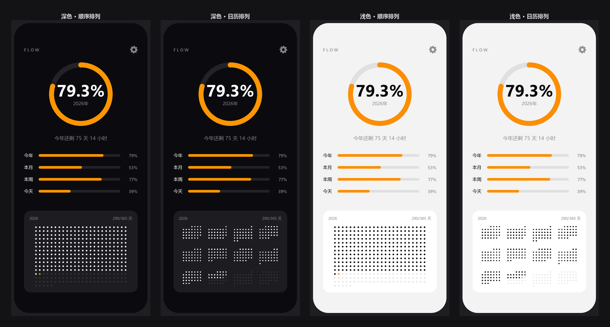
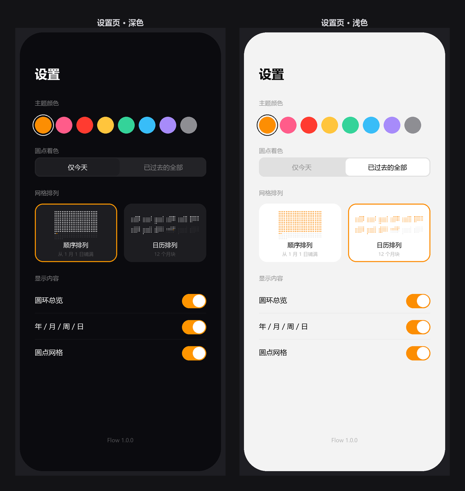
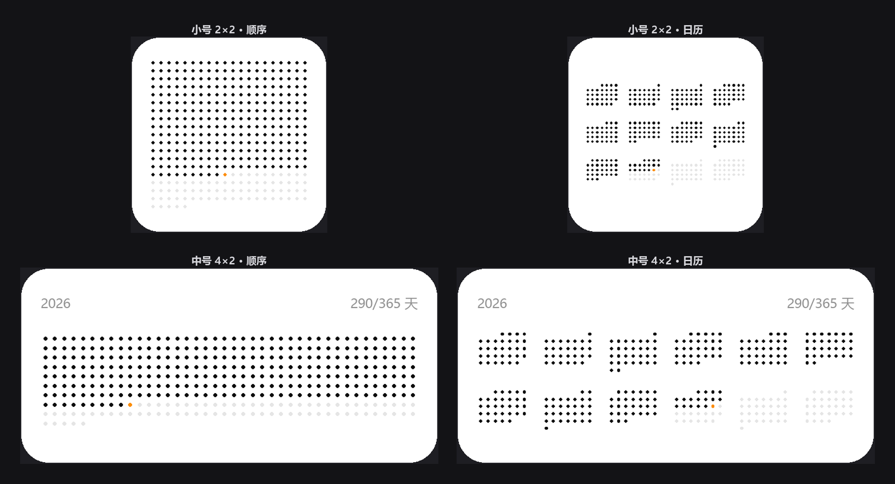
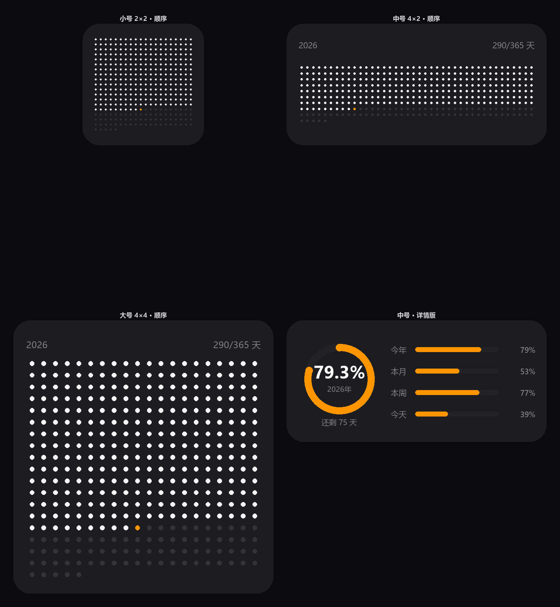
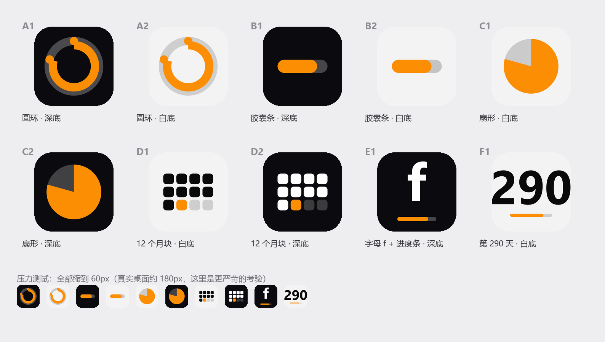

# Flow

**用 365 颗圆点，看这一年过去了多少。**

一个极简的年度进度 App + 桌面小组件。没有账号、没有网络请求、没有广告、没有分析 SDK —— 打开就是一个数字和一片圆点。

<p align="center">
  
</p>

---

## 目录

- [它长什么样](#它长什么样)
- [功能](#功能)
- [桌面小组件](#桌面小组件)
- [技术栈](#技术栈)
- [工程结构](#工程结构)
- [怎么编译（不需要 Mac）](#怎么编译不需要-mac)
- [怎么安装到 iPhone](#怎么安装到-iphone)
- [改代码之后怎么办](#改代码之后怎么办)
- [已知限制](#已知限制)
- [设计上的几个决定](#设计上的几个决定)

---

## 它长什么样

<p align="center">
  
</p>

左起：深色·顺序排列 / 深色·日历排列 / 浅色·顺序排列 / 浅色·日历排列。

<p align="center">
  
</p>

---

## 功能

### 主界面

| 区块 | 说明 |
|---|---|
| **大圆环** | 今年已经过去的百分比，中间是超大数字 + 年份。每秒刷新 |
| **剩余提示** | 「今年还剩 75 天 14 小时」 |
| **四条进度** | 今年 / 本月 / 本周 / 今天，四条横条并排对比 |
| **圆点网格** | 365 颗点，已过的是深色，今天是橙色，未到的是浅灰 |

### 两种网格排列

- **顺序排列** —— 1 月 1 日从左上角开始，一颗点一天，铺满整年。适合看「总量」。
- **日历排列** —— 12 个月块，每块 7 列（周一至周日）。适合看「节奏」。

设置页可以一键切换，切换时网格区域高度固定，不会跳动。

### 设置项

| 项目 | 选项 |
|---|---|
| 主题颜色 | 8 色：橙 `#FC8E03`、粉 `#FF5C8A`、红 `#FF3B30`、黄 `#FFC53D`、绿 `#34D399`、蓝 `#38BDF8`、紫 `#A78BFA`、灰 `#8E8E93` |
| 圆点着色 | 「仅今天」/「已过去的全部」 |
| 网格排列 | 顺序 / 日历，带实时预览卡片 |
| 显示内容 | 圆环总览、年/月/周/日、圆点网格，三个独立开关 |

全部设置立刻生效，并持久化到 `UserDefaults`。

---

## 桌面小组件

三种尺寸都支持，内容只有圆点网格（这才是主角）。

<p align="center">
  
</p>

- **小号 2×2** —— 只有网格，最纯粹的形态
- **中号 4×2** —— 网格 + 表头（年份 / 290/365 天）
- **大号 4×4** —— 同上，网格更大

<p align="center">
  
</p>

**刷新策略**：圆点一天只变一次（跨过 0 点，"今天"的橙点才往前挪一格），所以刷新时间定在**每天 0 点后 1 分钟**，而不是每 15 分钟。更准、也更省电。

---

## 技术栈

| 层 | 用了什么 |
|---|---|
| 语言 | **Swift 5** |
| 界面 | **SwiftUI**（圆点用 `Canvas` 一次绘制，365 个圆无性能压力） |
| 小组件 | **WidgetKit** + `TimelineProvider` |
| 最低系统 | **iOS 17.0** |
| 工程生成 | **XcodeGen**（`project.yml` 描述工程，不提交 `.xcodeproj`） |
| 编译 | **GitHub Actions**（macOS runner，免费） |
| 图标 | Python + Pillow 脚本生成 |

**零第三方依赖。** 整个 App 就是 8 个 Swift 文件，没有 Podfile、没有 Package.swift、没有网络权限。

---

## 工程结构

```
flow/
├── .github/workflows/build.yml   # 云端编译 + 打包 ipa
├── project.yml                   # XcodeGen 工程描述（唯一的工程定义）
├── Flow/
│   ├── App/
│   │   ├── FlowApp.swift         # @main 入口
│   │   ├── RootView.swift        # 主界面
│   │   └── SettingsView.swift    # 设置页
│   ├── Shared/                   # App 和小组件共用
│   │   ├── FlowMath.swift        # 所有时间计算（年/月/周/日进度、天数、圆点状态）
│   │   ├── FlowStore.swift       # 设置存储 + 颜色工具
│   │   ├── DotGrid.swift         # 365 圆点网格（Canvas）
│   │   └── ProgressViews.swift   # 圆环 + 进度条组件
│   ├── Widget/
│   │   └── FlowWidget.swift      # 小组件：Provider + 三种尺寸布局
│   └── Resources/
│       └── Assets.xcassets/      # 图标、主题色、启动背景
└── docs/                         # README 用的截图
```

### 数据是怎么流动的

```
FlowMath（纯函数，输入 Date，输出 Double）
   ↓
RootView / FlowWidget（渲染）
   ↑
FlowStore（@Published 设置项 → UserDefaults）
```

`FlowMath` 里所有函数都接受 `now: Date = Date()` 参数，**没有全局状态**，所以 App 和小组件算出来的数字永远一致。

核心 API：

```swift
FlowMath.yearProgress(now:)    // 0...1，精确到秒
FlowMath.monthProgress(now:)   // 0...1
FlowMath.weekProgress(now:)    // 0...1（周一为一周开始）
FlowMath.dayProgress(now:)     // 0...1
FlowMath.dayOfYear(now:)       // 今天是今年第几天（1 起）
FlowMath.daysRemaining(now:)   // 今年还剩几天
FlowMath.dots(now:)            // [DotState]，365 个元素
```

---

## 怎么编译（不需要 Mac）

iOS App 必须在 macOS + Xcode 上编译，Apple 从未发布 Windows 版。这个工程用 GitHub Actions 绕过：

1. 代码推到 GitHub
2. Actions 自动在 macOS runner 上跑 `xcodegen generate` → `xcodebuild build`
3. 产出**未签名**的 `Flow-unsigned.ipa`，从 Actions 页面下载

**全程零成本**：公开仓库的 Actions 分钟数无限。一次编译约 2 分钟。

<p align="center">
  
</p>

### workflow 关键配置

```yaml
runs-on: macos-15          # 自带 Xcode 16.4
# project.yml 里固定 xcodeVersion: "15.0"
# 否则新版 XcodeGen 会生成 Xcode 16 格式（objectVersion 77），老 Xcode 打不开
```

编译时关闭签名，因为签名在你的电脑上做：

```
CODE_SIGNING_ALLOWED=NO
CODE_SIGNING_REQUIRED=NO
CODE_SIGN_IDENTITY=""
```

### 在本地改代码

工程**不提交 `.xcodeproj`**，它由 `project.yml` 生成。如果你以后有了 Mac：

```bash
brew install xcodegen
cd flow
xcodegen generate
open Flow.xcodeproj
```

改了 Swift 文件不用重新跑 `xcodegen`（目录扫描是自动的）；只有新增/删除文件、改 target 配置时才需要。

---

## 怎么安装到 iPhone

因为不上架 App Store，需要用你自己的证书签名。要点如下：

1. 从 Actions 页面下载 `Flow-unsigned-ipa.zip`，解压得到 `.ipa`
2. 用签名工具（爱思助手 / Sideloadly / 轻松签）签名 —— **描述文件必须是通配符的**，否则小组件扩展签不上
3. 装到手机
4. 首次打开去 **设置 → 通用 → VPN与设备管理** 信任你的开发者证书
5. 长按桌面 → 左上角 `+` → 搜索 Flow → 选尺寸 → 添加小组件

### 签名踩坑提示

- 如果**小组件搜不到**，通常是签名时扩展漏签了。爱思助手有这个毛病，换 Sideloadly 一般能解决。
- 如果**装完闪退**，多半是描述文件和 Bundle ID 不匹配。App 的 ID 是 `com.zjzbs.flow`，扩展是 `com.zjzbs.flow.widget`。
- 免费开发者账号签的 App **7 天过期**，到期重签一次即可（数据不会丢）。

---

## 改代码之后怎么办

```
改 Swift 文件 → git commit → git push → Actions 自动编译 → 下载新 ipa → 重新签名安装
```

不用手动触发，push 到 `main` 就会跑。也可以在 Actions 页面点 **Run workflow** 手动触发。

---

## 已知限制

| 限制 | 原因 | 能不能解决 |
|---|---|---|
| **小组件不跟随 App 设置** | 没有启用 App Group 权限。为了让签名一次成功，这是有意的取舍 | 能，但要给扩展单独建 App ID + App Group，签名复杂度上升 |
| 小组件刷新有延迟 | iOS 的 Timeline 机制，系统会按自己的节奏调度 | 不能，这是系统行为 |
| App 图标不会随月份变化 | iOS 不支持动态 App 图标 | 不能。所以图标里橙色方块只当装饰，不表示"当前月" |
| 免费证书 7 天过期 | Apple 对免费账号的限制 | 付费开发者账号是 1 年 |
| 只能竖屏 | `UISupportedInterfaceOrientations` 只写了 Portrait | 能，改 `project.yml` 即可 |

---

## 设计上的几个决定

**为什么圆点直径是格子边长的 0.39？**
这是从 Life Widget 的截图上量出来的。试过 0.70，圆点几乎粘连成一团灰；0.39 才有那种疏松的质感。这个比例是「看起来像不像」的关键。

**为什么小组件用「顺序排列」当默认？**
顺序排列铺满整年，一眼能看出"走了多少、还剩多少"。日历排列更适合细看节奏，但不是第一眼该看到的东西。

**为什么没有 App Group？**
最初想做 App 和小组件联动，但那样需要给扩展单独建 App ID + App Group 权限，签名环节的失败率会明显上升。既然是自己侧载用，**一次装成功比功能完整更重要**。

**为什么用 XcodeGen 而不是直接提交 `.xcodeproj`？**
`.xcodeproj` 是一堆难以手写的 plist 和 pbxproj 文件，冲突时几乎无法解决。用 `project.yml` 描述工程，人和机器都好读，也不会有"这个文件在 Xcode 里点不出来"的问题。

**为什么每秒刷新一次主界面？**
圆环和百分比要平滑推进，不然看着像坏了。`TimelineView(.periodic(from: .now, by: 1))` 只重绘变化的部分，耗电可以忽略。

---

## 许可

个人自用项目，未上架 App Store。
