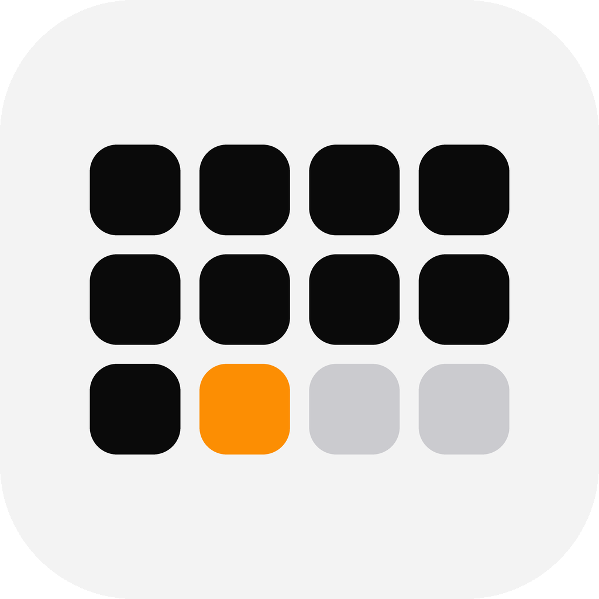

# Flow

**用 365 颗圆点，看这一年过去了多少。**

一个极简的年度进度 App + 桌面小组件。没有账号、没有网络请求、没有广告、没有分析 SDK —— 打开就是一个数字和一片圆点。

  

最低系统：**iOS 17.0**

---

## 怎么安装到 iPhone

因为不上架 App Store，需要用你自己的证书签名。要点如下：

1. 从 Actions 页面下载 `Flow-unsigned-ipa.zip`，解压得到 `.ipa`
2. 用签名工具（爱思助手 / Sideloadly / 轻松签）签名 —— **描述文件必须是通配符的**，否则小组件扩展签不上
3. 装到手机
4. 首次打开去 **设置 → 通用 → VPN与设备管理** 信任你的开发者证书
5. 长按桌面 → 左上角 `+` → 搜索 Flow → 选尺寸 → 添加小组件
